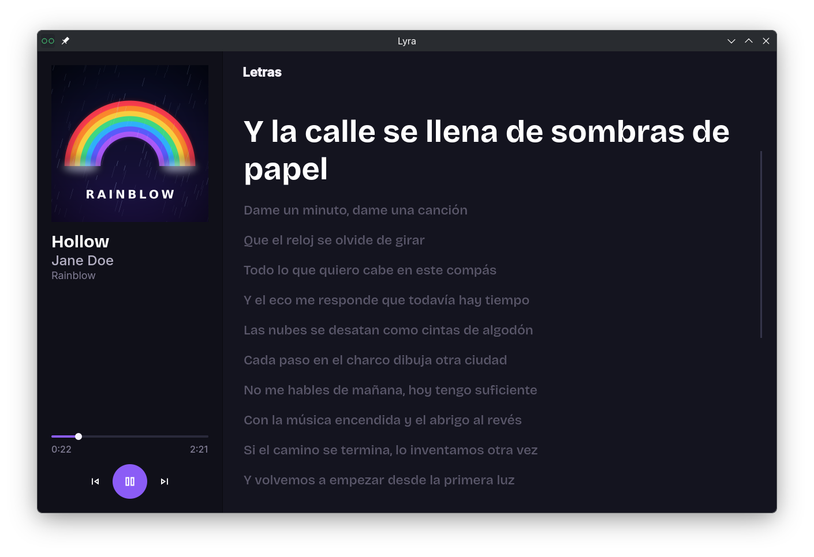

# Lyra

Reproductor de música local para archivos FLAC. Escanea la carpeta que elijas, organiza tus pistas según su metadata y construye una biblioteca (SQLite) con artistas, álbumes, portadas y letras sincronizadas.

> **Antes de empezar:** Lyra **mueve, renombra y modifica** tus archivos. Haz una copia de seguridad de tu música antes de usarla por primera vez. Los detalles están en [Qué hace con tus archivos](#qué-hace-con-tus-archivos).

## Descarga

Los binarios para Linux y Windows están en [Releases](../../releases).

- **Linux:** `chmod +x lyra && ./lyra`
- **Windows:** ejecuta `lyra.exe`

## Cómo espera tu música

- Solo se leen archivos **`.flac`**.
- Se buscan en la carpeta que selecciones, **incluidas todas sus subcarpetas**.
- Lyra intenta no depender de la metadata: si falta alguna etiqueta, usa un valor por defecto en lugar de omitir la pista. Una pista sin etiquetas aparece en la biblioteca, aunque sea con un nombre poco bonito.

### Etiquetas que lee

| Etiqueta      | Formato                                                | Si falta                                                    |
| ------------- | ------------------------------------------------------ | ----------------------------------------------------------- |
| `TITLE`       | Texto                                                  | Se usa el nombre del archivo                                |
| `ALBUM`       | Texto                                                  | `Unknown`                                                   |
| `ALBUMARTIST` | Texto. Varios artistas separados por `;`               | Se usa `ARTIST`; si tampoco hay, `No Artist`                |
| `ARTIST`      | Texto. Varios artistas separados por `;`               | Se usa `ALBUMARTIST`                                        |
| `TRACKNUMBER` | Número (`3`) o `3/12`                                  | Sin número. Un valor que no sea un número también se ignora |
| `LYRICS`      | Letra sincronizada en formato LRC (`[01:23.45] texto`) | Sin letra                                                   |

Notas:

- De las letras solo se conservan las líneas con marca de tiempo. Una letra sin marcas se descarta.
- Si la pista tiene imagen incrustada, se usa la primera como portada del álbum.
- Dos álbumes se consideran el mismo si tienen **el mismo título y los mismos artistas de álbum**, en el mismo orden.

## Qué hace con tus archivos

Al procesar la carpeta, Lyra:

- **Mueve y renombra** cada pista a `<carpeta>/<artista del álbum>/<álbum>/<título>.flac`. Si hay varios artistas de álbum, la carpeta se llama `Artista A, Artista B`.
- **Guarda la portada** como `cover.jpg` (o `cover.png`, según la imagen) en la carpeta del álbum.
- **Elimina la etiqueta `COMMENT`** de los archivos FLAC.
- **Crea `library.db`** en la carpeta elegida.

Además:

- Los caracteres que no se permiten en nombres de archivo (`< > : " / \ | ? *`) se sustituyen por `_`. Por ejemplo, `AC/DC` se guarda como `AC_DC`.
- Los nombres demasiado largos se acortan.
- Nunca se sobrescribe una pista. Si dos acabarían con el mismo nombre, la segunda se guarda como `Título (2).flac`.
- Un archivo corrupto o que no se pueda procesar se omite y el resto continúa.
- Si vuelves a procesar una carpeta ya organizada, las pistas que ya están en su sitio se dejan como están.

## Problemas conocidos

- **Windows:** el antivirus o SmartScreen puede mostrar un aviso porque el ejecutable no está firmado.
- **Linux:** al ejecutar Lyra desde la terminal pueden aparecer avisos de Fontconfig (`invalid attribute 'xsi:nil'`, `invalid constant used`). No afectan al funcionamiento.

## Próximas versiones

- [ ] Recarga de la base de datos
- [ ] Configuración de temas
- [ ] Interfaz de configuración
- [ ] Descarga de letras usando liblrc
- [ ] ...
